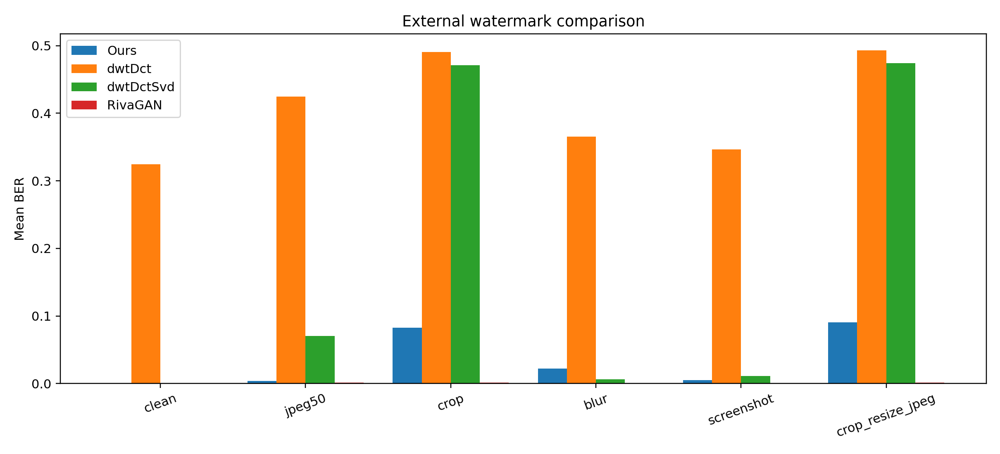

# 外部水印基线对比

## 方法说明

- `Ours`：128 位结构化载荷 + RS(32,16) + 4 次重复，总编码长度 1024 位，包含数据库联合验证。
- `external dwtDct`：`invisible-watermark` 库的 DWT-DCT 实现，嵌入同样的 1024 位编码载荷。
- `external dwtDctSvd`：`invisible-watermark` 库的 DWT-DCT-SVD 实现，嵌入同样的 1024 位编码载荷。
- `RivaGAN`：预训练神经水印模型，原生 32 位载荷，无法承载本文的 128 位结构化载荷。
- 公平比较口径：四种方法均使用共同可用的 50 张正样本。
- 全量 200 张上的本方法结果另见 `results_full_capture_scan/`：PSNR 39.65 dB，SSIM 0.998980。

## 结果对比

| Method | Payload bits | n | PSNR | SSIM | JPEG50 | Crop | Blur | Screenshot | Crop+Resize+JPEG |
|---|---:|---:|---:|---:|---:|---:|---:|---:|---:|
| Ours (structured + DB, matched subset) | 1024 | 50 | 40.33 | 0.999302 | 1.00 | 0.94 | 1.00 | 1.00 | 0.88 |
| external dwtDct | 1024 | 50 | 37.76 | 0.999999 | 0.00 | 0.00 | 0.00 | 0.00 | 0.00 |
| external dwtDctSvd | 1024 | 50 | 37.68 | 1.000000 | 0.72 | 0.00 | 1.00 | 1.00 | 0.00 |
| RivaGAN (pretrained) | 32 | 50 | 40.48 | 0.999918 | 1.00 | 1.00 | 1.00 | 1.00 | 1.00 |

## 主要结论

- 外部 `dwtDct` 即使干净图也无法可靠恢复 1024 位载荷，因此不适合作为长结构化载荷载体。
- 外部 `dwtDctSvd` 可以承载 1024 位并在干净图、模糊和截图上表现较好，但裁剪和裁剪组合攻击失败。
- `RivaGAN` 的画质和鲁棒性最好，但只支持 32 位载荷，不能承载本文的完整结构化来源信息。
- 本文方法在 128 位结构化载荷、1024 位编码长度和数据库联合验证条件下，裁剪与组合攻击表现明显优于外部 dwtDct/dwtDctSvd。
- RivaGAN 的结果只能作为短载荷鲁棒性参照，不能视为同等载荷条件下的直接竞争基线。

## 图

