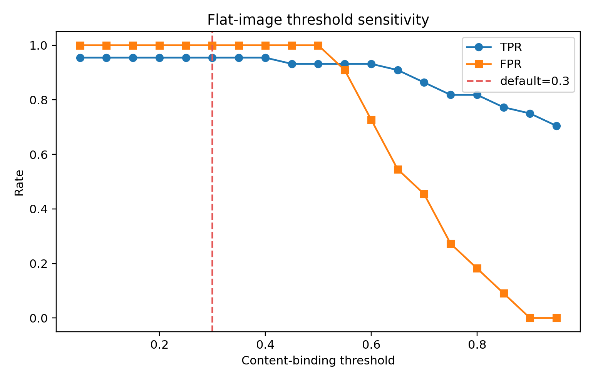

# 极端平坦图像内容绑定阈值敏感性

## 实验配置

- 平坦图像：11 张
- 正样本攻击测试：44 条
- 复制攻击测试：11 条
- 攻击类型：clean, jpeg, real_screen_capture, print_scan
- 默认阈值：0.3

## ORB 回退情况

- 正样本使用平均哈希回退的比例：0.9091

## 分数范围

- 正样本最低/最高：0.0294 / 1.0000
- 复制攻击最低/最高：0.5424 / 0.8611

## 阈值推荐

- 推荐阈值：0.90
- 对应 TPR：0.7500
- 对应 FPR：0.0000
- Youden J：0.7500

## 默认阈值结果

- 默认阈值：0.3
- TPR：0.9545
- FPR：1.0000

## 自适应策略

- 正常纹理图像阈值：0.3
- 平坦图像回退阈值：0.9
- 平坦图像 TPR：0.7500
- 平坦图像 FPR：0.0000

