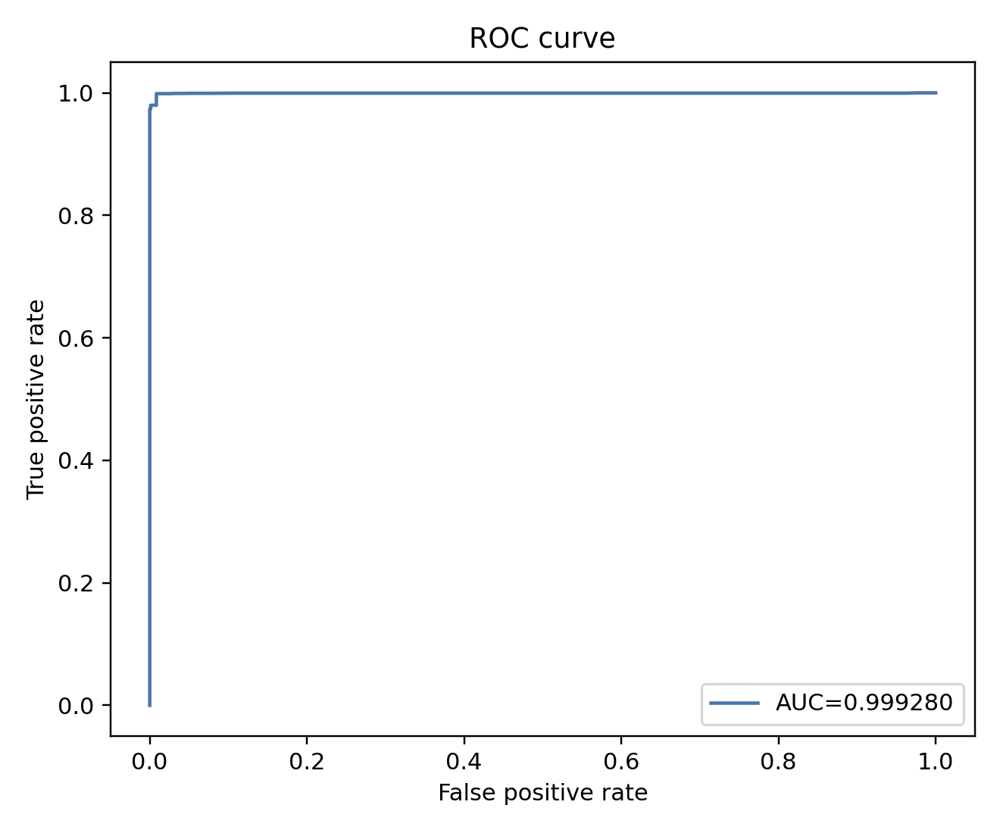
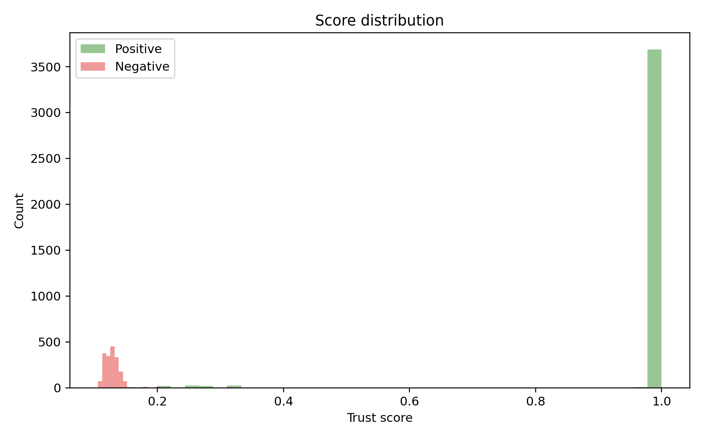

# 阈值校准报告

- Positive score samples: 3800
- Negative score samples: 1900
- ROC AUC: 0.999280
- Calibrated high threshold (target FPR 0.001): 0.322822
- Calibrated medium threshold (target FPR 0.01): 0.200625

## Target FPR

| Target FPR | Threshold | Achieved FPR | Achieved TPR |
|---:|---:|---:|---:|
| 0.100 | 0.142969 | 0.108947 | 0.999474 |
| 0.050 | 0.150000 | 0.055263 | 0.999211 |
| 0.020 | 0.184219 | 0.021579 | 0.998684 |
| 0.010 | 0.200625 | 0.013684 | 0.998684 |
| 0.005 | 0.310156 | 0.008421 | 0.979737 |
| 0.001 | 0.322822 | 0.001053 | 0.979474 |

## Current thresholds

| Threshold | FPR | TPR |
|---|---:|---:|
| current_medium=0.55 | 0.000000 | 0.971842 |
| current_high=0.75 | 0.000000 | 0.971842 |

## Figures

