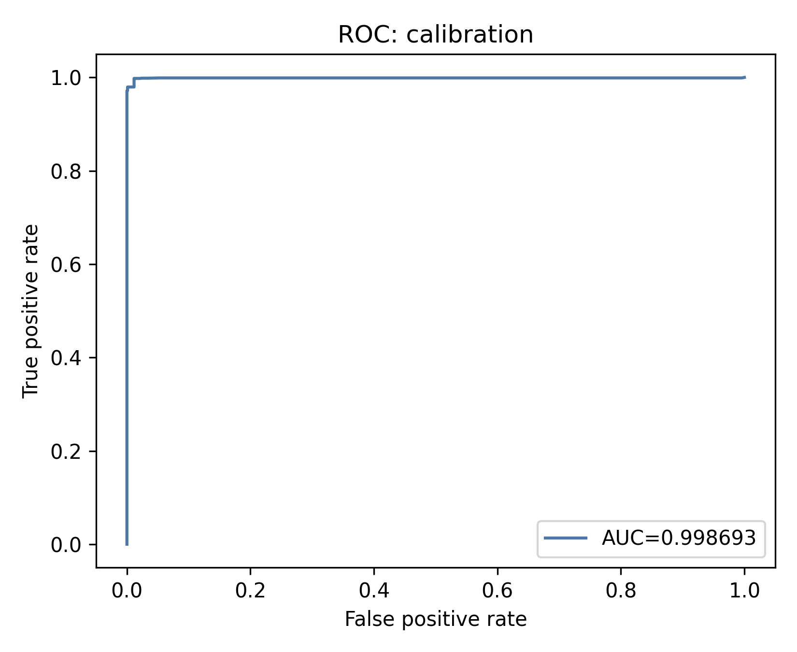
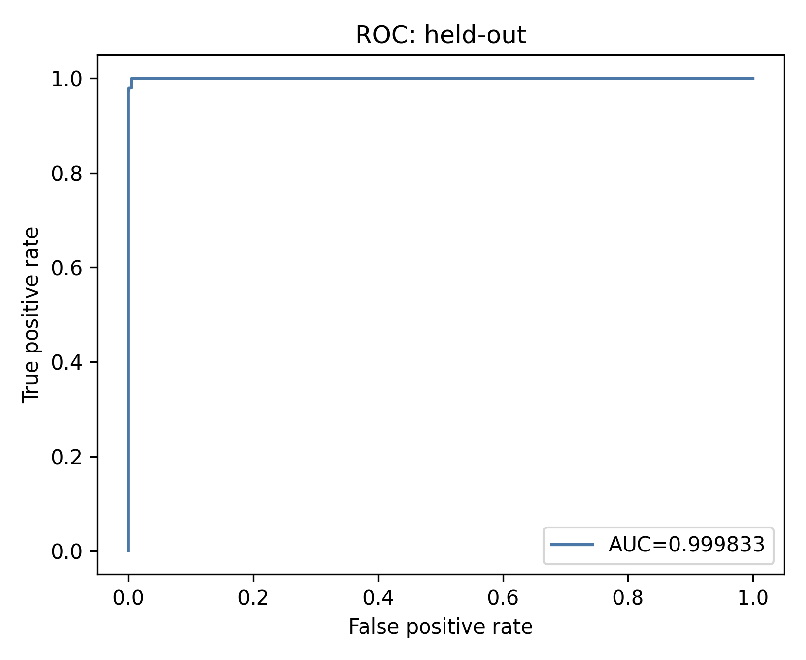
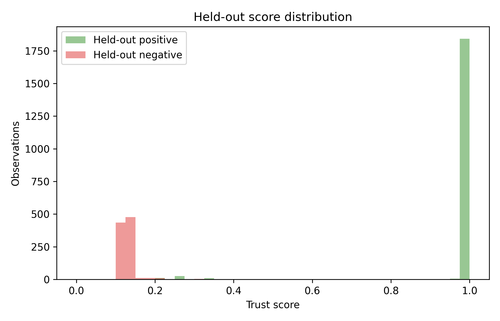

# Image-Disjoint Threshold Calibration

## Split

- Calibration positive images: 100
- Held-out positive images: 100
- Calibration negative images: 50
- Held-out negative images: 50
- Calibration positive observations: 1900
- Held-out positive observations: 1900
- Calibration negative observations: 950
- Held-out negative observations: 950

## AUC

- Calibration AUC: 0.998693 (cluster bootstrap 95% CI 0.996138--0.999970)
- Held-out AUC: 0.999833 (cluster bootstrap 95% CI 0.999570--1.000000)

## Threshold transfer

| Target FPR | Threshold | Cal FPR | Cal TPR | Test FPR | Test TPR |
|---:|---:|---:|---:|---:|---:|
| 0.100 | 0.140625 | 0.1821 | 0.9989 | 0.1547 | 1.0000 |
| 0.050 | 0.150000 | 0.0537 | 0.9989 | 0.0568 | 0.9995 |
| 0.020 | 0.174844 | 0.0211 | 0.9979 | 0.0284 | 0.9995 |
| 0.010 | 0.310156 | 0.0116 | 0.9795 | 0.0053 | 0.9800 |
| 0.005 | 0.310156 | 0.0116 | 0.9795 | 0.0053 | 0.9800 |
| 0.001 | 0.331250 | 0.0011 | 0.9716 | 0.0011 | 0.9747 |

## Current operational thresholds on held-out data

| Threshold | Value | FPR | TPR |
|---|---:|---:|---:|
| operational_high | 0.55 | 0.0000 | 0.9732 |
| operational_medium | 0.32 | 0.0032 | 0.9800 |

The split is by generation image, so attack variants of the same image
never cross the calibration and held-out sets.

